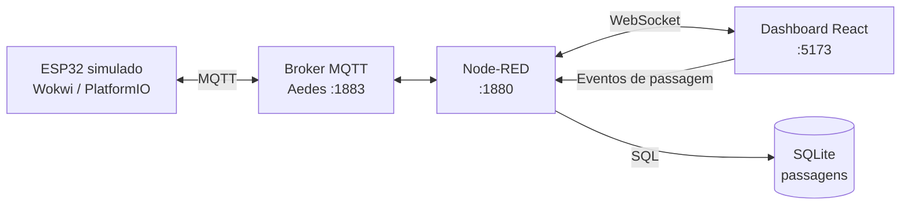

# 🚦 DevOps IoT | Semáforo Inteligente

> Projeto acadêmico de Internet das Coisas (IoT) aplicado à mobilidade urbana, reutilizado para a disciplina de **DevOps** da **FATEC Sorocaba**. O sistema integra um ESP32 simulado, comunicação MQTT, processamento no Node-RED, persistência SQLite e um dashboard interativo em React.

## 📑 Sumário

- [1. Contexto e problema](#1-contexto-e-problema)
- [2. Objetivo e escopo](#2-objetivo-e-escopo)
- [3. Requisitos funcionais](#3-requisitos-funcionais)
- [4. Requisitos não funcionais](#4-requisitos-não-funcionais)
- [5. Tecnologias](#5-tecnologias)
- [6. Arquitetura](#6-arquitetura)
- [7. Estrutura do repositório](#7-estrutura-do-repositório)
- [8. Pré-requisitos](#8-pré-requisitos)
- [9. Instalação e configuração](#9-instalação-e-configuração)
- [10. Execução](#10-execução)
- [11. APIs e comunicação](#11-apis-e-comunicação)
- [12. Banco de dados](#12-banco-de-dados)
- [13. Variáveis de ambiente](#13-variáveis-de-ambiente)
- [14. Testes automatizados e CI](#14-testes)
- [15. Build e deploy](#15-build-e-deploy)
- [16. Limitações e melhorias futuras](#16-limitações-e-melhorias-futuras)

## 1. Contexto e problema

Em cruzamentos urbanos, a operação de semáforos precisa conciliar a circulação de veículos e a travessia segura de pedestres. Também é útil registrar passagens e identificar eventos de risco, como veículos que avançam o sinal vermelho.

O **Semáforo Inteligente** é um protótipo educacional que demonstra a integração de dispositivos IoT, troca de mensagens, regras de negócio, armazenamento de eventos e visualização em tempo real.

**Importante:** a implementação atual **não ajusta automaticamente a duração dos sinais com base no volume de tráfego**. O ciclo é predefinido, com adaptação a pedidos de travessia. O controle adaptativo por fluxo é uma evolução proposta.

## 2. Objetivo e escopo

### Objetivo geral

Construir e documentar uma aplicação IoT integrada que simule um semáforo, receba eventos de sensores, registre passagens de veículos e apresente informações em um dashboard, com um processo reprodutível de instalação, teste, build e publicação do frontend.

### Objetivos específicos

- Simular o controle de um semáforo veicular e de pedestres em ESP32.
- Receber pedidos de travessia pelo botão físico simulado ou pelo dashboard.
- Transmitir telemetria e comandos por MQTT.
- Registrar passagens e identificar infrações simuladas de avanço no vermelho.
- Consultar indicadores e histórico por API HTTP e dashboard.
- Disponibilizar uma demonstração do frontend sem infraestrutura IoT, usando simulação no navegador.
- Automatizar a compilação e a publicação estática do frontend no GitHub Pages.

### Dentro do escopo

Firmware e circuito simulados no Wokwi; integração MQTT; fluxos Node-RED; banco SQLite; API HTTP; dashboard React com carros e pedestre em pixel art; testes de integração e deploy estático do frontend.

### Fora do escopo atual

Instalação física em vias públicas, reconhecimento real de placas, emissão oficial de multas, operação em tempo real com garantias de segurança viária, hospedagem do backend no GitHub Pages e otimização dinâmica de sinais por contagem de veículos.

## 3. Requisitos funcionais

| ID | Requisito | Situação |
|---|---|---|
| RF01 | Controlar os LEDs do semáforo veicular em ciclo verde, amarelo e vermelho. | Implementado |
| RF02 | Sinalizar a travessia de pedestres quando o sinal veicular estiver vermelho. | Implementado |
| RF03 | Receber solicitação de travessia pelo botão físico simulado e pelo dashboard. | Implementado |
| RF04 | Reduzir o verde após solicitação de pedestre e ampliar o vermelho seguinte. | Implementado |
| RF05 | Publicar estado e disponibilidade do ESP32 por MQTT. | Implementado |
| RF06 | Detectar aproximação no HC-SR04 e registrar evento de passagem. | Implementado |
| RF07 | Simular veículos no dashboard e comunicar a passagem ao Node-RED. | Implementado |
| RF08 | Validar eventos e armazenar passagens com identificação do veículo e cor oficial do sinal. | Implementado |
| RF09 | Identificar passagens no vermelho como infrações **simuladas**. | Implementado |
| RF10 | Exibir estado, tempo restante, indicadores, alertas e histórico no dashboard. | Implementado |
| RF11 | Disponibilizar consultas HTTP para passagens, infrações e estatísticas. | Implementado |
| RF12 | Executar uma demonstração inteiramente no navegador, sem Node-RED. | Implementado |
| RF13 | Ajustar automaticamente os tempos a partir do volume de veículos. | Planejado |

## 4. Requisitos não funcionais

| ID | Requisito / decisão técnica | Como é atendido ou verificado |
|---|---|---|
| RNF01 | **Modularidade:** separar firmware, integração, banco e interface. | Diretórios `wokwi/`, `node-red/`, `database/` e `frontend/`. |
| RNF02 | **Interoperabilidade:** utilizar protocolos e formatos comuns. | MQTT, WebSocket, HTTP e JSON. |
| RNF03 | **Integridade dos registros:** não confiar na cor enviada pelo frontend. | Node-RED utiliza o último estado oficial publicado pelo ESP32. |
| RNF04 | **Validação de eventos:** rejeitar dados inválidos ou duplicados. | Placas permitidas e janela de 3 segundos por placa. |
| RNF05 | **Observabilidade básica:** indicar perda de comunicação e dados desatualizados. | Status do ESP32, alertas e reconexão do WebSocket. |
| RNF06 | **Reprodutibilidade:** documentar dependências, configuração e comandos. | README, arquivos de configuração e lockfiles do npm. |
| RNF07 | **Portabilidade da demonstração:** permitir acesso sem instalar o backend. | Build estático React/Vite e modo de simulação. |
| RNF08 | **Persistência local:** manter histórico entre reinicializações do backend. | Banco SQLite em arquivo. |
| RNF09 | **Automação de entrega do frontend:** build e deploy a partir do Git. | GitHub Actions + GitHub Pages. |

> Estes itens descrevem características e mecanismos do projeto, não certificações ou garantias de desempenho, disponibilidade e segurança para uso em trânsito real.

## 5. Tecnologias

| Camada | Tecnologias | Responsabilidade |
|---|---|---|
| Dispositivo IoT | ESP32, C++, Arduino, PlatformIO, Wokwi | Lógica do semáforo e leitura dos componentes |
| Mensageria | MQTT, PubSubClient, Aedes | Telemetria e comandos |
| Backend e integração | Node-RED 5, JavaScript | Processamento, validação, APIs e WebSocket |
| Banco de dados | SQLite | Histórico de passagens |
| Frontend | React 19, TypeScript, Vite | Dashboard e simulação visual |
| DevOps | Git, GitHub Actions, GitHub Pages | Versionamento, build e publicação estática |

## 6. Arquitetura



**Fluxo do semáforo:** ESP32 publica estado por MQTT → Node-RED processa → WebSocket atualiza o dashboard.

**Fluxo dos veículos:** os carros são animados **no dashboard**, não no Wokwi. Ao cruzar o sensor visual, o frontend envia um evento → Node-RED valida → consulta a cor oficial do ESP32 → grava no SQLite → retorna confirmação e, se aplicável, alerta de infração e comando para o buzzer.

**Modo de demonstração:** `?fonte=simulacao` executa a lógica simulada no navegador, sem persistência no SQLite.

### Temporização do firmware

- Verde: **12 s**.
- Amarelo: **3 s**.
- Vermelho: **8 s**.
- Com solicitação de pedestre durante o verde: verde encerrado em até **3 s** e vermelho seguinte de **10 s**.
- Solicitações feitas durante o vermelho são ignoradas.

### Componentes do Wokwi

| Componente | GPIO |
|---|---|
| LEDs veiculares (vermelho, amarelo, verde) | 25, 26, 27 |
| LEDs de pedestres (vermelho, verde) | 32, 33 |
| Botão de travessia (`INPUT_PULLUP`) | 14 |
| HC-SR04 (`TRIG`, `ECHO`) | 5, 18 |
| Buzzer | 13 |

O HC-SR04 gera um evento de veículo `WOKWI` ao detectar distância inferior a 50 cm. O buzzer emite um sinal para passagem regular e três para infração simulada.

## 7. Estrutura do repositório

```text
DevOps_IOT_Semaforo/
├── .github/
│   └── workflows/
│       └── deploy-pages.yml       # CI/CD do frontend
├── docs/                          # Material complementar
├── semaforo-inteligente/
│   ├── semaforo.code-workspace    # Workspace e tarefas do VS Code
│   ├── wokwi/
│   │   ├── src/main.cpp
│   │   ├── include/config.h
│   │   ├── platformio.ini
│   │   ├── diagram.json
│   │   └── wokwi.toml
│   ├── node-red/
│   │   ├── flows.json
│   │   ├── settings.js
│   │   ├── package.json
│   │   └── scripts/esp32-fake.mjs
│   ├── database/
│   │   └── schema.sql
│   └── frontend/
│       ├── src/
│       ├── index.html
│       ├── vite.config.ts
│       └── package.json
├── .gitignore
└── README.md
```

Arquivos gerados como `node_modules/`, `frontend/dist/`, `.pio/` e `database/semaforo.db` não devem ser versionados.

## 8. Pré-requisitos

- **Node.js:** versão compatível com as dependências instaladas. O backend declara `>=22.9`; para o frontend com Vite 8, utilize preferencialmente **Node.js 22.12+ ou 24+**. Confirme a versão com `node -v`.
- **npm**, instalado com Node.js.
- **Git** e **Visual Studio Code**.
- Extensões **PlatformIO IDE** e **Wokwi Simulator** para o firmware.
- Navegador moderno.
- Opcional: **DB Browser for SQLite** para consultar o banco.

> No Windows PowerShell, se `npm.ps1` estiver bloqueado, utilize `npm.cmd` nos comandos abaixo.

## 9. Instalação e configuração

### 9.1. Clonar o repositório

```bash
git clone https://github.com/SEU-USUARIO/DevOps_IOT_Semaforo.git
cd DevOps_IOT_Semaforo
```

Substitua `SEU-USUARIO` pelo proprietário real do repositório.

### 9.2. Instalar as dependências do backend

No terminal, a partir da raiz do repositório:

```powershell
cd semaforo-inteligente/node-red
npm.cmd install
```

### 9.3. Instalar as dependências do frontend

Abra outro terminal na raiz do repositório:

```powershell
cd semaforo-inteligente/frontend
npm.cmd install
```

Em Linux/macOS, substitua `npm.cmd` por `npm`.

### 9.4. Configuração do ESP32

Revise `semaforo-inteligente/wokwi/include/config.h` para conferir Wi-Fi, broker MQTT, tópicos e tempos. No Wokwi executado localmente, a configuração documentada utiliza `host.wokwi.internal` e a porta `1883`.

O Node-RED deve estar em execução antes de iniciar a simulação para que o ESP32 consiga se conectar ao broker local.

## 10. Execução

### Opção A: integração completa

1. Abra `semaforo-inteligente/semaforo.code-workspace` no VS Code.
2. Execute **Terminal → Run Task → Subir Node-RED + Frontend**.
3. Execute **Terminal → Run Task → Firmware: compilar (PlatformIO)**.
4. Abra `wokwi/diagram.json` e execute **Wokwi: Start Simulator** pela paleta de comandos.
5. Acesse o dashboard em `http://localhost:5173`.
6. Acesse o editor do Node-RED em `http://localhost:1880`.

O firmware é compilado pelo PlatformIO, gerando `firmware.bin` e `firmware.elf` no diretório de build configurado. **Após alterar o firmware, compile novamente e reinicie a simulação.**

### Opção B: execução manual dos serviços

Em um terminal na pasta `semaforo-inteligente/node-red`:

```powershell
npm.cmd start
```

Em outro terminal na pasta `semaforo-inteligente/frontend`:

```powershell
npm.cmd run dev
```

Depois, compile o firmware pelo PlatformIO e inicie o Wokwi.

### Opção C: backend com ESP32 de teste

Sem abrir o Wokwi, execute em `semaforo-inteligente/node-red`:

```powershell
npm.cmd run esp32-fake
```

Comandos do simulador: `p` (pedestre), `c` (veículo) e `q` (sair). **Não execute o ESP32 de teste simultaneamente com o Wokwi**, pois ambos publicam nos mesmos tópicos.

### Opção D: somente frontend

Inicie o Vite e acesse:

`http://localhost:5173/?fonte=simulacao`

Nesse modo, o navegador simula os dados sem Node-RED e **não grava passagens no SQLite**.

## 11. APIs e comunicação

### API HTTP do Node-RED

Base local: `http://localhost:1880`

| Método | Endpoint | Resposta |
|---|---|---|
| GET | `/api/passagens?limite=10` | Últimas passagens |
| GET | `/api/infracoes` | Passagens no vermelho (até 100) |
| GET | `/api/estatisticas` | Totais por cor e registros do dia |
| GET | `/api/resumo-por-placa` | Total, passagens por cor e infrações por veículo |

Exemplo de consulta:

```powershell
curl.exe "http://localhost:1880/api/passagens?limite=10"
```

### WebSocket

Endpoint local: `ws://localhost:1880/ws/semaforo`.

O backend envia telemetria, confirmações de passagens e alertas. O frontend envia pedidos de travessia e eventos de veículos, por exemplo:

```json
{"type":"botao_virtual"}
```

```json
{"type":"passagem","placa":"2","sinal":"RED"}
```

A cor enviada pelo frontend **não determina o registro no banco**: o Node-RED usa o último estado recebido do ESP32.

### MQTT

Prefixo: `fatec/semaforo/01`

| Tópico (sufixo) | Sentido | Finalidade |
|---|---|---|
| `/estado` | ESP32 → Node-RED | Cor, tempo restante e estado |
| `/status` | ESP32 → Node-RED | Disponibilidade, Wi-Fi e uptime |
| `/sensor/botao` | ESP32 → Node-RED | Acionamento físico simulado |
| `/sensor/veiculo` | ESP32 → Node-RED | Detecção pelo HC-SR04 |
| `/cmd/botao_virtual` | Node-RED → ESP32 | Pedido pelo dashboard |
| `/cmd/passagem` | Node-RED → ESP32 | Notificação de passagem registrada |

## 12. Banco de dados

O SQLite é inicializado pelo Node-RED a partir de `semaforo-inteligente/database/schema.sql`. O arquivo `semaforo.db` é gerado localmente e **não deve ser enviado ao Git**.

### Tabela `passagens`

| Campo | Descrição |
|---|---|
| `id` | Identificador inteiro autoincremental |
| `registrado_em` | Data/hora ISO 8601 em UTC |
| `placa` | Identificador do veículo (`1`, `2`, `3` ou `WOKWI`) |
| `sinal` | Cor do semáforo (`VERDE`, `AMARELO` ou `VERMELHO`) |

**Views:** `v_infracoes` e `v_resumo_por_placa`.

**Validação:** eventos com placa desconhecida, ESP32 sem estado válido/offline ou duplicidade da mesma placa em menos de 3 segundos são rejeitados.

Para reiniciar os dados, pare o Node-RED antes de remover o arquivo SQLite e eventuais arquivos auxiliares (`-wal` e `-shm`). Essa operação apaga o histórico local.

## 13. Variáveis de ambiente

O frontend utiliza variáveis Vite, lidas em `src/services/telemetry/config.ts`.

| Variável | Exemplo local | Uso |
|---|---|---|
| `VITE_DATA_SOURCE` | `websocket` | Fonte de dados padrão |
| `VITE_NODE_RED_WS_URL` | `ws://localhost:1880/ws/semaforo` | Endpoint WebSocket |
| `VITE_NODE_RED_HTTP_URL` | `http://localhost:1880` | API HTTP |
| `GITHUB_PAGES` | `true` durante o build | Define o `base` no `vite.config.ts`, caso configurado |

O frontend permite substituir a fonte pela URL: `?fonte=ws` ou `?fonte=simulacao`; `?ws=...` e `?api=...` configuram endpoints alternativos.

O Node-RED também utiliza configurações de caminho de banco e schema em `node-red/settings.js`, incluindo `SEMAFORO_DB` e `SEMAFORO_SCHEMA`, quando aplicáveis.

**Segurança:** não coloque senhas ou tokens secretos em variáveis `VITE_*`, pois elas são incorporadas ao JavaScript distribuído ao navegador.

## 14. Testes automatizados e CI

O projeto contém um teste de integração em `semaforo-inteligente/node-red/scripts/teste-integracao.mjs`, executado pelo test runner nativo do Node.js (`node:test`). O script simula mensagens de um ESP32 via MQTT e comandos do dashboard via WebSocket, e verifica o processamento do Node-RED e os dados consultados pelas APIs HTTP.

### Cobertura existente

1. Inicialização do banco vazio.
2. Recusa de passagem antes da primeira telemetria do ESP32.
3. Recebimento do estado MQTT pelo dashboard.
4. Persistência da cor oficial do ESP32 e marcação de infração.
5. Recusa de passagem duplicada em menos de três segundos.
6. Recusa de placa desconhecida.
7. Passagem no verde sem infração.
8. Registro de detecção do HC-SR04 com placa `WOKWI`.
9. Encaminhamento do botão virtual ao ESP32 por MQTT.
10. Consulta das APIs de passagens, infrações, estatísticas e resumo por placa.
11. Indicação de ESP32 offline na telemetria.

### Executar localmente (PowerShell)

No terminal 1, dentro de `semaforo-inteligente/node-red`:

```powershell
$env:SEMAFORO_DB = Join-Path $env:TEMP 'semaforo-teste-integracao.db'
Remove-Item $env:SEMAFORO_DB -ErrorAction SilentlyContinue
npm.cmd start
```

No terminal 2, na mesma pasta:

```powershell
npm.cmd run test:integracao
```

**Importante:** pare o Wokwi e o `esp32-fake` antes dos testes. O script exige um banco vazio e utiliza os mesmos tópicos MQTT do ESP32. Use uma base exclusiva para testes para não apagar os dados da demonstração.

### Pipeline de CI/CD

A Action `.github/workflows/deploy-pages.yml` executa em pushes e pull requests para `main`:

- `validar-frontend`: `npm ci`, `npm run lint` e `npm run build`.
- `testar-integracao`: inicia o Node-RED com banco SQLite isolado e executa `npm run test:integracao`.
- `deploy`: publica no GitHub Pages **somente se os dois jobs anteriores terminarem com sucesso** e o evento não for um pull request.

A execução bem-sucedida deve ser verificada na aba **Actions** do repositório. Os testes de integração não substituem testes de firmware físico, testes de interface no navegador nem testes de carga.


### Cenários de integração

| Cenário | Procedimento | Resultado esperado |
|---|---|---|
| Sincronização | Iniciar Wokwi, Node-RED e dashboard | Cores e tempos do dashboard acompanham o ESP32 |
| Solicitação de pedestre | Clicar no botão do poste durante o verde | Verde termina em até 3 s e próximo vermelho dura 10 s |
| Registro de passagem | Aguardar um carro cruzar o sensor visual | Evento validado, histórico atualizado e aviso no dashboard |
| Infração simulada | Aguardar veículo avançar o vermelho | Registro no banco e alerta de infração |
| Sensor físico simulado | Ajustar HC-SR04 para menos de 50 cm | Passagem `WOKWI` registrada |
| ESP32 indisponível | Parar Wokwi | Dashboard informa dados desatualizados/offline |
| Node-RED indisponível | Parar Node-RED | Dashboard indica perda de conexão e tenta reconectar |
| Modo sem backend | Abrir `?fonte=simulacao` | Dashboard opera sem Node-RED e sem persistência |
| Build de produção | Executar `npm.cmd run build` | Pasta `dist/` gerada sem erros |

**Registre evidências** (capturas de tela, logs e resultado de cada cenário) em `docs/`, se exigidas na avaliação. A tabela descreve critérios de aceite, não afirma que todos os testes foram executados.

## 15. Build e deploy

### 15.1. Build local

Na pasta `semaforo-inteligente/frontend`:

```powershell
npm.cmd run build
npm.cmd run preview
```

### 15.2. GitHub Actions e GitHub Pages

O workflow `.github/workflows/deploy-pages.yml` instala dependências, executa lint/build e publica `semaforo-inteligente/frontend/dist` no GitHub Pages.

No repositório, configure **Settings → Pages → Build and deployment → Source: GitHub Actions**.

O endereço publicado terá o formato:

`https://SEU-USUARIO.github.io/DevOps_IOT_Semaforo/`

O GitHub Pages **hospeda apenas o frontend estático**. Para demonstrar sem backend, use:

`https://SEU-USUARIO.github.io/DevOps_IOT_Semaforo/?fonte=simulacao`

Se o `index.html` tiver o script que ativa automaticamente `fonte=simulacao` em `github.io`, o parâmetro não será necessário.

O workflow fornecido neste pacote usa `main` como branch de publicação. Pull requests são validados por lint/build, mas **não publicam**.

### 15.3. O que não é publicado no Pages

Node-RED, broker MQTT, SQLite e Wokwi **não são executados pelo GitHub Pages**. A integração completa permanece disponível localmente; uma implantação integral em nuvem exigiria serviços de backend e conectividade seguros.

## 16. Limitações e melhorias futuras

- **Controle adaptativo por fluxo:** calcular tempos de sinal com base na contagem real de veículos.
- **Testes automatizados:** adicionar testes unitários e integração do backend.
- **CI mais abrangente:** validar fluxos Node-RED e compilação do firmware no pipeline.
- **Implantação completa:** hospedar backend e broker com autenticação, TLS e monitoramento.
- **Segurança:** adicionar controle de acesso e proteção das interfaces caso o sistema seja exposto à internet.
- **Observabilidade:** métricas, logs centralizados e alertas operacionais.

---

**Contexto acadêmico:** protótipo originalmente desenvolvido para **Programação Multiplataforma** e adaptado para documentação, versionamento e automação de entrega na disciplina de **DevOps** da **FATEC Sorocaba**.
